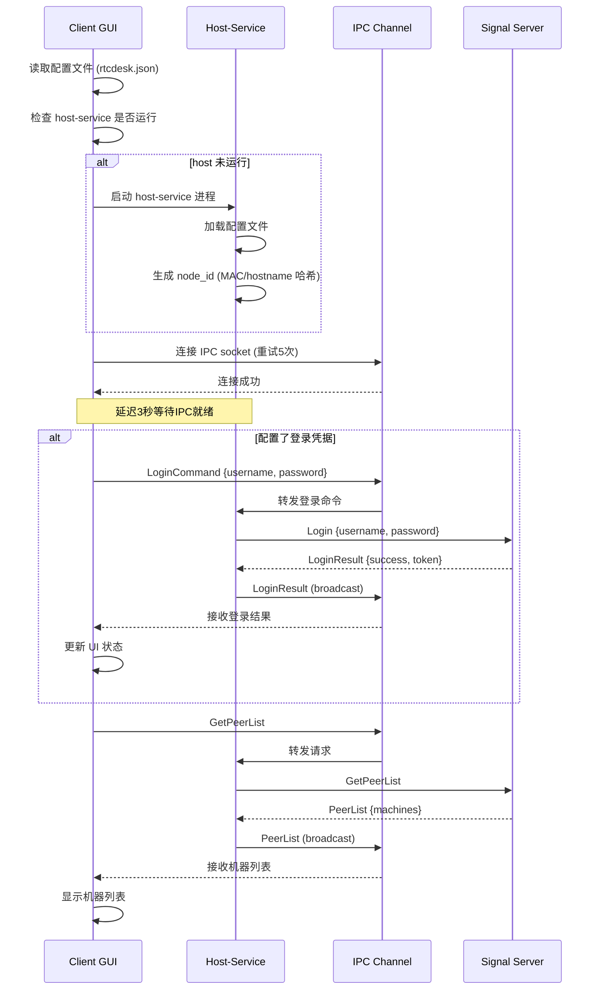
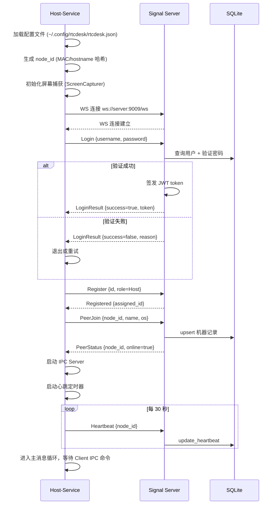
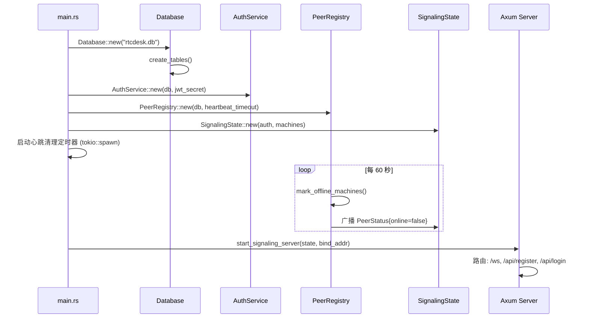
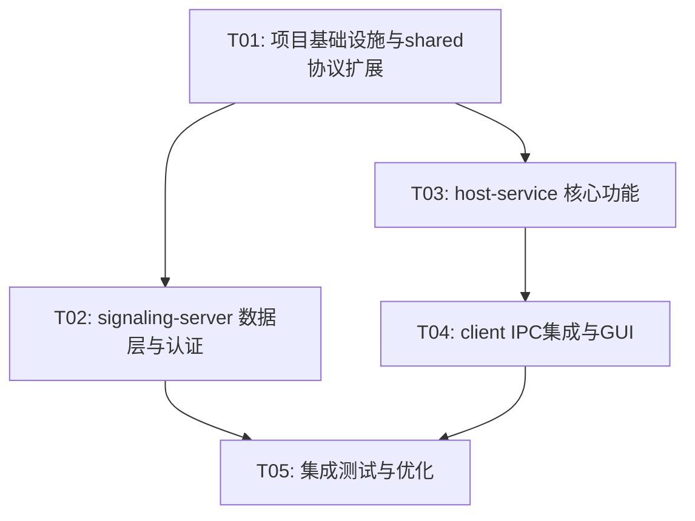

# 系统架构设计：RTCDesk 三层架构与 IPC 代理

## Part A：系统设计

---

### 1. 架构概述

#### 1.1 核心设计理念

RTCDesk 采用 **Client-Host-Signal 三层架构**，通过 IPC 代理实现信号通信隔离：

- **Client (Viewer)**: GUI 应用，负责用户交互和远程桌面显示
- **Host-Service**: 后台服务，负责所有 Signal 交互和屏幕捕获
- **Signal Server**: 信令服务器，负责认证、机器注册和信令转发
- **IPC 代理**: Client 与 Host-Service 通过本地 IPC 通信，Host-Service 代理所有 Signal 交互

#### 1.2 功能需求

##### Host-Service 功能

1. **可安装为系统服务** 
   - Linux: systemd user service
   - Windows: Windows Service
   - 配置文件: `~/.config/rtcdesk/rtcdesk.json`

2. **可由 Client 拉起**
   - Client 启动时自动检测并启动 host-service
   - 通过 `HostProcess::spawn()` 派生子进程

3. **负责与 Signal 所有交互**
   - 启动时机器注册上线 (`Register` + `PeerJoin`)
   - 代理 Client 的登录/登出请求
   - 代理机器列表请求与响应
   - 广播机器状态变更通知

4. **负责接受远程 Client 连接控制**
   - WebRTC 连接建立 (Offer/Answer/ICE 交换)
   - 屏幕捕获与编码 (支持 VA-API 硬件加速)
   - 响应远程鼠标/键盘输入
   - 剪贴板双向同步
   - 文件传输

##### Client 功能

1. **启动时拉起 Host**
   - 检测 host-service 是否运行
   - 如未运行，自动启动 host 进程
   - 等待 IPC 连接就绪

2. **自动登录 (Host 代理)**
   - 从配置文件读取登录凭据
   - 通过 IPC 发送登录命令到 host-service
   - 接收登录结果并更新 UI 状态

3. **拉取最新机器列表 (Host 代理)**
   - 通过 IPC 发送机器列表请求
   - Host-service 转发到 signal server
   - 接收并显示机器列表及在线状态
   - 实时接收机器状态变更通知

#### 1.3 核心技术挑战

| 挑战 | 分析 | 方案 |
|------|------|------|
| **服务边界划分** | Client 不应直接与 Signal 通信 | 通过 IPC 代理，Host-Service 统一处理 Signal 交互 |
| **IPC 通信** | 跨平台本地进程通信 | 使用 interprocess 2.4 (Unix sockets / Windows named pipes) |
| **认证体系** | 用户认证 + JWT token | JWT + SQLite 用户存储；Host-Service 代理认证 |
| **配置统一** | Client 和 Host 需要共享配置 | 统一使用 `rtcdesk.json` 配置文件 |
| **机器身份持久化** | node_id 需要稳定 | 使用 MAC/hostname 哈希生成 9 位数字 ID |
| **心跳与在线状态** | 需要实时机器状态 | Host-Service 定时心跳，IPC 广播状态变更 |
| **WebRTC 信令代理** | Offer/Answer/ICE 需通过 IPC 转发 | Host-Service 完整代理 WebRTC 信令 |

#### 1.4 架构模式

- **signaling-server**：经典 Axum 服务器架构（Router + State + Handler），新增认证中间件层
- **host-service**：事件驱动架构（WS 消息循环 + WebRTC 事件回调 + 定时心跳 + IPC 服务器）
- **client**：Dioxus GUI 应用 + IPC 客户端 + WebRTC Viewer
- **通信**：
  - Client ↔ Host-Service: IPC (interprocess)
  - Host-Service ↔ Signal Server: WebSocket
  - Client ↔ Host-Service (WebRTC data): WebRTC P2P DataChannel

#### 1.5 框架与库选型

| 库 | 用途 | 选型理由 |
|----|------|----------|
| axum 0.8 (已有) | signaling-server HTTP/WS 框架 | 已在用，成熟稳定 |
| rusqlite 0.31 | signaling-server 用户存储 | 本地 SQLite，轻量无外部依赖 |
| jsonwebtoken 9 | JWT 签发与验证 | Rust 生态主流 JWT 库 |
| argon2 0.5 | 密码哈希 | OWASP 推荐的密码哈希算法 |
| chrono 0.4 | 时间处理（JWT 过期时间等） | 已在 client 中使用，生态成熟 |
| dirs 6 | 配置文件路径 | 跨平台标准路径获取 |
| **interprocess 2.4** | **IPC 通信** | **跨平台 LocalSocket/Named Pipes，tokio 支持** |
| serde_json | IPC 消息序列化 | JSON-line 协议，易于调试 |

---

### 2. 文件列表

#### 2.1 signaling-server 目录结构

```
signaling-server/
├── Cargo.toml
└── src/
    ├── main.rs              # 入口：解析配置、初始化DB、启动axum服务
    ├── ws_handler.rs        # WS信令处理（从 service/signaling.rs 迁移+重构）
    ├── auth.rs              # 用户注册/登录、JWT签发/验证、认证中间件
    ├── db.rs                # SQLite数据访问层（用户表、机器表）
    └── machine.rs           # 机器注册、在线状态、心跳检查、机器列表查询
```

#### 2.2 host-service 目录结构

```
host-service/
├── Cargo.toml
└── src/
    ├── main.rs              # 入口：配置加载、登录、注册机器、主循环
    ├── signal_client.rs     # 信令客户端：WS连接、登录、心跳、消息收发
    ├── ipc_server.rs        # IPC服务器：接收client命令并转发到signal
    ├── peer.rs              # WebRTC Peer（从 service/peer.rs 迁移）
    └── capture.rs           # 屏幕捕获（从 service/capture.rs 迁移）
```

#### 2.3 client 目录结构

```
client/
├── Cargo.toml
└── src/
    ├── main.rs             # 应用入口 + 窗口管理 + 自动启动host
    ├── viewer.rs           # WebRTC 连接管理 + 帧接收
    ├── viewer_ipc.rs       # IPC 信令代理 (替代直接WebSocket)
    ├── ipc_client.rs       # IPC 客户端
    ├── ipc_machine.rs      # IPC 机器状态管理
    ├── config.rs           # 配置持久化 + 连接历史
    ├── host_process.rs     # Host 进程管理 + systemd 服务
    ├── components/         # UI 组件
    │   ├── auth.rs         # 登录/注册表单 + 自动登录
    │   ├── home.rs         # 主页 (机器列表)
    │   ├── host.rs         # Host 模式页 + 服务管理
    │   └── ...
    └── remote/             # 远程会话模块
        ├── viewer_loop.rs  # Viewer 主循环 (帧接收/分发)
        └── ...
```

#### 2.4 shared 目录结构

```
shared/
├── Cargo.toml
└── src/
    ├── lib.rs              # 模块导出
    ├── signal.rs           # 信令消息枚举定义
    ├── ipc.rs              # IPC 消息协议 (ClientCommand/HostMessage)
    ├── frame.rs            # 帧分片协议 + FrameAssembler
    ├── auth.rs             # JWT Claims 类型
    └── local_id.rs         # 本地设备 ID 生成
```

#### 2.5 workspace Cargo.toml

```toml
[workspace]
members = ["tools", "shared", "signaling-server", "host-service", "client"]
```

---

### 3. 数据结构与接口

#### 3.1 架构图

```
┌──────────────────────────────────────────────────────────────────────────┐
│                          RTCDesk 架构 (Workspace)                        │
├──────────────────────────────────────────────────────────────────────────┤
│                                                                          │
│  ┌──────────────────────────────────────────────────────────────────┐   │
│  │                    Client GUI (Viewer)                            │   │
│  │  ┌──────────┐  ┌──────────┐  ┌──────────┐  ┌────────────┐      │   │
│  │  │ Auto-    │  │ Auto-    │  │ Peer  │  │ Remote     │      │   │
│  │  │ Launch   │  │ Login    │  │ List     │  │ Desktop    │      │   │
│  │  │ Host     │  │ (IPC)    │  │ (IPC)    │  │ Viewer     │      │   │
│  │  └─────────────────────────────────────────────────────────┘      │   │
│  │                          │ IPC (interprocess)                     │   │
│  └──────────────────────────┼───────────────────────────────────────┘   │
│                             │                                            │
│  ┌──────────────────────────┼───────────────────────────────────────┐   │
│  │                    Host-Service                                   │   │
│  │  ┌───────────────────────┼──────────────────────────────────┐   │   │
│  │  │  IPC Server           │                                   │   │   │
│  │  │  ├─ Login/Logout      │                                   │   │   │
│  │  │  ├─ PeerList       │                                   │   │   │
│  │  │  ├─ WebRTC Signaling  │                                   │   │   │
│  │  │  └─ Status Broadcast  │                                   │   │   │
│  │  └───────────────────────┼──────────────────────────────────┘   │   │
│  │                          │                                       │   │
│  │  ┌───────────────────────┼──────────────────────────────────┐   │   │
│  │  │  Signal Client        │                                   │   │   │
│  │  │  ├─ Register/ Login   │                                   │   │   │
│  │  │  ├─ Peer Register  │                                   │   │   │
│  │  │  ├─ Peer List      │                                   │   │   │
│  │  │  └─ WebRTC Peer       │                                   │   │   │
│  │  └───────────────────────┼──────────────────────────────────┘   │   │
│  │                          │                                       │   │
│  │  ┌───────────────────────┼──────────────────────────────────┐   │   │
│  │  │  Screen Capturer      │                                   │   │   │
│  │  │  ├─ VA-API Encode     │                                   │   │   │
│  │  │  ├─ Input Handler     │                                   │   │   │
│  │  │  └─ Clipboard Sync    │                                   │   │   │
│  │  └──────────────────────────────────────────────────────────┘   │   │
│  └─────────────────────────────────────────────────────────────────┘   │
│                             │ WebSocket                                │
│  ┌──────────────────────────┼───────────────────────────────────────┐   │
│  │                    Signal Server                                   │   │
│  │  ┌──────────────────────┼──────────────────────────────────┐     │   │
│  │  │  Authentication       │                                  │     │   │
│  │  │  Peer Registry     │                                  │     │   │
│  │  │  Signaling Proxy      │                                  │     │   │
│  │  └──────────────────────────────────────────────────────────┘     │   │
│  └─────────────────────────────────────────────────────────────────┘   │
│                                                                          │
│  ┌───────────────────┐                                                    │
│  │   shared          │  共享模块：帧协议、信令消息、IPC协议、本地ID       │
│  └───────────────────┘                                                    │
└──────────────────────────────────────────────────────────────────────────┘
```

#### 3.2 IPC 协议定义

##### ClientCommand (Client → Host)

```rust
#[derive(Debug, Clone, Serialize, Deserialize)]
#[serde(tag = "type", rename_all = "snake_case")]
pub enum ClientCommand {
    /// 用户登录
    Login {
        username: String,
        password: String,
    },
    /// 用户登出
    Logout,
    /// 用户注册
    Register {
        username: String,
        password: String,
        email: String,
    },
    /// 绑定机器
    PeerBind {
        node_id: String,
        name: String,
        os: String,
    },
    /// 解绑机器
    PeerUnbind {
        node_id: String,
    },
    /// 请求机器列表
    GetPeerList,
    /// Viewer 连接请求
    ViewerConnect {
        viewer_id: String,
        node_id: String,
        password: String,
    },
    /// Viewer Answer SDP
    ViewerAnswer {
        viewer_id: String,
        node_id: String,
        sdp: String,
    },
    /// Viewer ICE 候选
    ViewerIceCandidate {
        viewer_id: String,
        node_id: String,
        candidate: String,
        sdp_mid: Option<String>,
        sdp_mline_index: Option<u16>,
    },
    /// Viewer 画质更新
    ViewerQualityUpdate {
        viewer_id: String,
        quality: u32,
        max_dimension: u32,
        fps: u32,
        bitrate_kbps: u32,
    },
    /// 获取状态
    GetStatus,
}
```

##### HostMessage (Host → Client)

```rust
#[derive(Debug, Clone, Serialize, Deserialize)]
#[serde(tag = "type", rename_all = "snake_case")]
pub enum HostMessage {
    /// 连接状态更新
    ConnectionStatus {
        status: ConnectionState,
        message: String,
    },
    /// 机器在线状态
    PeerStatus {
        node_id: String,
        name: String,
        os: String,
        online: bool,
    },
    /// 机器列表
    PeerList {
        machines: Vec<PeerInfo>,
    },
    /// 命令执行结果
    CommandResult {
        success: bool,
        message: String,
    },
    /// 认证状态
    AuthStatus {
        logged_in: bool,
        username: String,
    },
    /// 登录结果
    LoginResult {
        success: bool,
        token: String,
        reason: String,
    },
    /// 注册结果
    RegisterResult {
        success: bool,
        message: String,
    },
    /// Viewer: Offer SDP
    ViewerOffer {
        from: String,
        to: String,
        sdp: String,
    },
    /// Viewer: ICE 候选
    ViewerIceCandidate {
        from: String,
        to: String,
        candidate: String,
        sdp_mid: Option<String>,
        sdp_mline_index: Option<u16>,
    },
    /// Viewer: 认证结果
    ViewerAnswer {
        viewer_id: String,
        accepted: bool,
        reason: String,
    },
    /// Viewer: Peer 离开
    ViewerPeerLeft {
        id: String,
    },
    /// Viewer: 错误
    ViewerError {
        message: String,
    },
}
```

##### PeerInfo

```rust
#[derive(Debug, Clone, Serialize, Deserialize)]
pub struct PeerInfo {
    pub node_id: String,
    pub name: String,
    pub os: String,
    pub online: bool,
}
```

##### ConnectionState

```rust
#[derive(Debug, Clone, Serialize, Deserialize)]
#[serde(rename_all = "snake_case")]
pub enum ConnectionState {
    Connecting,
    Connected,
    Reconnecting { attempt: u32 },
    Error { reason: String },
}
```

#### 3.3 SignalMessage 关键变体

```rust
// shared/src/signal.rs

/// 用户登录请求
Login {
    username: String,
    password: String,
},

/// 登录结果
LoginResult {
    success: bool,
    token: String,
    reason: String,
},

/// Host 注册机器信息
PeerJoin {
    node_id: String,
    name: String,
    os: String,
},

/// 在线机器列表
PeerList {
    machines: Vec<PeerInfo>,
},

/// 机器在线状态变更通知
PeerStatus {
    node_id: String,
    online: bool,
},

/// 心跳消息（Host 定期发送）
Heartbeat {
    node_id: String,
},

/// WebRTC Offer
Offer {
    from: String,
    to: String,
    sdp: String,
},

/// WebRTC Answer
Answer {
    from: String,
    to: String,
    sdp: String,
},

/// ICE 候选
IceCandidate {
    from: String,
    to: String,
    candidate: String,
    sdp_mid: Option<String>,
    sdp_mline_index: Option<u16>,
},

/// 连接请求
ConnectRequest {
    from: String,
    target_id: String,
    pic_quality: u32,
    password: String,
},

/// 认证结果
Answer {
    from: String,
    to: String,
    accepted: bool,
    reason: String,
},
```

#### 3.4 数据库表结构

**users 表：**
```sql
CREATE TABLE IF NOT EXISTS users (
    id          INTEGER PRIMARY KEY AUTOINCREMENT,
    username    TEXT NOT NULL UNIQUE,
    password_hash TEXT NOT NULL,
    created_at  TEXT NOT NULL DEFAULT (datetime('now'))
);
```

**machines 表：**
```sql
CREATE TABLE IF NOT EXISTS machines (
    machine_id    TEXT PRIMARY KEY,
    user_id       INTEGER NOT NULL,
    name          TEXT NOT NULL DEFAULT '',
    os            TEXT NOT NULL DEFAULT '',
    last_heartbeat INTEGER NOT NULL DEFAULT 0,
    online        INTEGER NOT NULL DEFAULT 0,
    FOREIGN KEY (user_id) REFERENCES users(id)
);
```

---

### 4. 程序调用流程

#### 4.1 Client 启动流程



#### 4.2 Host-Service 启动流程



#### 4.3 WebRTC 连接流程 (通过 IPC 代理)

```mermaid
sequenceDiagram
    participant V as Viewer (client)
    participant IPC as IPC Channel
    participant H as Host-Service
    participant S as Signal Server

    V->>IPC: ViewerConnect {viewer_id, node_id, password}
    IPC->>H: 转发 ConnectRequest
    H->>S: ConnectRequest {from, target_id, password}
    S->>S: 验证 token 有效
    S->>H: 转发 ConnectRequest

    alt 密码正确
        H-->>S: Answer {accepted=true}
        S-->>H: 转发 Answer
        H->>IPC: ViewerAnswer {accepted=true} (broadcast)
        IPC-->>V: 接收认证结果
    else 密码错误
        H-->>S: Answer {accepted=false, reason}
        S-->>H: 转发 Answer
        H->>IPC: ViewerAnswer {accepted=false} (broadcast)
        IPC-->>V: 接收认证失败
    end

    H->>H: 创建 RtcPeer + DataChannel
    H->>S: Offer {from=host, to=viewer, sdp}
    S-->>H: 转发 Offer
    H->>IPC: ViewerOffer {sdp} (broadcast)
    IPC-->>V: 接收 Offer

    V->>IPC: ViewerAnswer {sdp}
    IPC->>H: 转发 Answer
    H->>S: Answer {from=viewer, to=host, sdp}
    S-->>H: 转发 Answer
    H->>H: set_remote_description(Answer)
    H->>H: start_streaming(fps)

    loop ICE 候选 (Host → Viewer)
        H->>H: 生成 ICE candidate
        H->>IPC: ViewerIceCandidate (broadcast)
        IPC-->>V: 接收 ICE
    end

    loop ICE 候选 (Viewer → Host)
        V->>IPC: ViewerIceCandidate
        IPC->>H: 转发 ICE
        H->>S: IceCandidate
        S-->>H: 转发 ICE
        H->>H: add_ice_candidate
    end

    H->>H: ICE 连接建立，开始推流
    Note over V,H: WebRTC P2P DataChannel 建立
    H->>V: JPEG 帧 ("desktop" channel)
    V->>H: 输入事件 ("input" channel)
    V<->H: 剪贴板 ("clipboard" channel)
```

#### 4.4 信令服务器启动流程



---

### 5. 配置文件

#### 5.1 统一配置文件

**路径:** 
- Linux: `~/.config/rtcdesk/rtcdesk.json`
- Windows: `%APPDATA%\rtcdesk\rtcdesk.json`
- macOS: `~/Library/Application Support/rtcdesk/rtcdesk.json`

**格式:**
```json
{
  "server_addr": "ws://your-signal-server:9009",
  "login_username": "your-username",
  "login_password": "your-password",
  "host_password": "optional-host-password",
  "stun_servers": [
    "stun:stun.l.google.com:19302",
    "stun:stun1.l.google.com:19302"
  ],
  "local_id": "123456789",
  "theme": "dark",
  "locale": "zh-CN",
  "quality": 1
}
```

**字段说明:**
- `server_addr`: Signal Server WebSocket 地址
- `login_username`: 登录用户名
- `login_password`: 登录密码
- `host_password`: Host 访问密码（可选，空表示开放访问）
- `stun_servers`: STUN 服务器列表（用于 NAT 穿透）
- `local_id`: 本地设备 ID（9位数字，自动生成）
- `theme`: UI 主题（"dark" 或 "light"）
- `locale`: 语言区域（如 "zh-CN", "en"）
- `quality`: 画质预设索引（0-3）

---

### 6. 待明确事项

| # | 事项 | 当前假设 | 建议 |
|---|------|----------|------|
| 1 | Viewer 是否也需要登录获取 token？ | 是，通过 Host-Service 代理登录 | PM 需确认：是否所有 Viewer 都需账号，或允许匿名 Viewer |
| 2 | JWT secret 如何配置？ | 环境变量 `RTCDESK_JWT_SECRET`，首次自动生成 | 建议首次启动自动生成并持久化到文件 |
| 3 | 机器列表是仅返回自己的机器，还是返回所有在线机器？ | P0 返回所有在线机器（简单方案） | 后续可加用户隔离 |
| 4 | 配置文件路径？ | `~/.config/rtcdesk/rtcdesk.json` (统一配置) | 使用 dirs crate 跨平台处理 |
| 5 | IPC socket 名称冲突？ | 使用 `rtcdesk-host` 作为 socket 名称 | 可考虑添加用户标识避免冲突 |
| 6 | SQLite 数据文件位置？ | signaling-server 同目录下 `rtcdesk.db` | 可通过环境变量覆盖 |

---

## Part B：任务分解

---

### 7. 所需依赖包

#### signaling-server 依赖

```
rusqlite@0.31         # SQLite 数据库
jsonwebtoken@9        # JWT 签发/验证
argon2@0.5            # 密码哈希（Argon2id）
chrono@0.4            # 时间处理
```

#### host-service 依赖

```
dirs@6                # 跨平台配置目录
serde_json@1          # 配置文件读写
interprocess@2.4      # IPC 通信 (tokio)
tokio                 # 异步运行时
```

#### client 依赖

```
dioxus@0.7            # GUI 框架
interprocess@2.4      # IPC 通信 (tokio)
webrtc-rs@0.20        # WebRTC 实现
```

#### shared 依赖

```
serde@1               # 序列化
serde_json@1          # JSON 序列化
chrono@0.4            # 时间类型
```

---

### 8. 任务列表

#### T01：项目基础设施与 shared 协议扩展

**任务描述**：更新 workspace Cargo.toml、创建 crate 的 Cargo.toml、扩展 shared/signal.rs 新增信令消息类型、新增 shared/ipc.rs 定义 IPC 协议、新增 shared/auth.rs 定义 JWT Claims。

**涉及文件**：
- `Cargo.toml` (workspace root)
- `shared/Cargo.toml`
- `shared/src/lib.rs`
- `shared/src/signal.rs`
- `shared/src/ipc.rs` (新增)
- `shared/src/auth.rs`
- `signaling-server/Cargo.toml`
- `host-service/Cargo.toml`
- `client/Cargo.toml`

**前置依赖**：无

**优先级**：P0

**预估复杂度**：M

---

#### T02：signaling-server 数据层与认证模块

**任务描述**：实现 SQLite 数据访问层（db.rs）、认证服务（auth.rs）、机器注册/心跳/在线状态管理（machine.rs）、main.rs 初始化 DB 和启动服务器。

**涉及文件**：
- `signaling-server/src/db.rs`
- `signaling-server/src/auth.rs`
- `signaling-server/src/machine.rs`
- `signaling-server/src/main.rs`
- `signaling-server/src/ws_handler.rs`

**前置依赖**：T01

**优先级**：P0

**预估复杂度**：L

---

#### T03：host-service 核心功能

**任务描述**：实现 signal_client.rs（WS 客户端）、ipc_server.rs（IPC 服务器）、main.rs（配置加载、登录、注册、主循环）、peer.rs、capture.rs。

**涉及文件**：
- `host-service/src/signal_client.rs`
- `host-service/src/ipc_server.rs` (新增)
- `host-service/src/main.rs`
- `host-service/src/peer.rs`
- `host-service/src/capture.rs`

**前置依赖**：T01

**优先级**：P0

**预估复杂度**：L

---

#### T04：client IPC 集成与 GUI

**任务描述**：实现 ipc_client.rs（IPC 客户端）、ipc_machine.rs（机器状态管理）、viewer_ipc.rs（WebRTC 信令代理）、main.rs（自动启动 host、自动登录）、host_process.rs（进程管理）、UI 组件更新。

**涉及文件**：
- `client/src/ipc_client.rs` (新增)
- `client/src/ipc_machine.rs` (新增)
- `client/src/viewer_ipc.rs` (新增)
- `client/src/main.rs`
- `client/src/host_process.rs`
- `client/src/components/auth.rs`
- `client/src/components/home.rs`
- `client/src/components/host.rs`
- `client/src/remote/viewer_loop.rs`

**前置依赖**：T01, T03

**优先级**：P0

**预估复杂度**：L

---

#### T05：集成测试与优化

**任务描述**：编写集成测试（登录→注册→心跳→消息转发→WebRTC 建立）、验证端到端流程、性能优化、错误处理完善。

**涉及文件**：
- `tests/` 或各 crate 内 `tests/` (新增集成测试)
- 各模块错误处理优化

**前置依赖**：T02, T03, T04

**优先级**：P1

**预估复杂度**：M

---

### 9. 共享知识

```
- 所有 WS 信令消息使用 JSON 序列化，格式为 SignalMessage 枚举（serde tag = "type"）
- IPC 消息使用 JSON-line 协议（newline-terminated JSON）
- 认证 token 通过 Login/LoginResult 流程获取，Host-Service 代理认证
- JWT token 有效期 24 小时，过期前 1 小时可刷新
- 密码哈希使用 Argon2id 算法
- 机器 ID 使用 MAC/hostname 哈希生成 9 位数字 ID
- 心跳间隔：host-service 每 30 秒发送；signaling-server 超时阈值 90 秒
- 所有错误通过 SignalMessage::Error 或 HostMessage::ViewerError 返回
- 环境变量命名约定：RTCDESK_ 前缀（仅用于调试，生产使用配置文件）
- 日志使用 log crate + env_logger，级别 info 为默认
- 数据库文件默认路径：./rtcdesk.db（可通过环境变量覆盖）
- 配置文件路径：~/.config/rtcdesk/rtcdesk.json (统一配置)
- IPC socket 名称：rtcdesk-host
- 新旧协议兼容：不再支持旧版直接 WebSocket 通信，所有信号通过 IPC 代理
```

---

### 10. 任务依赖图



**说明**：T02 和 T03 可以并行开发（仅依赖 T01），T04 依赖 T03 的 IPC 服务器，T05 需要所有功能完成后进行集成测试。
