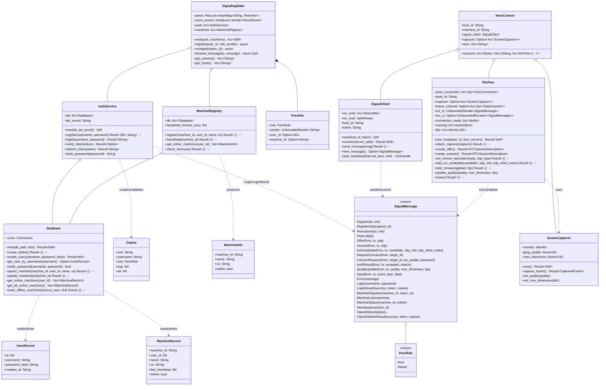
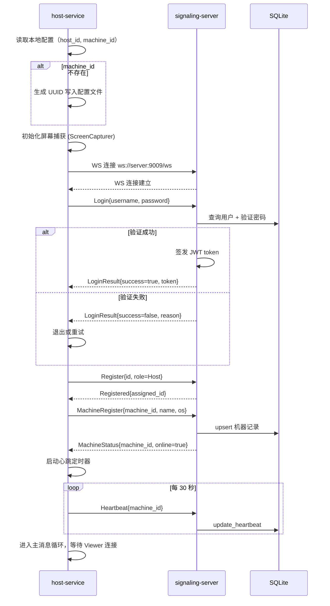
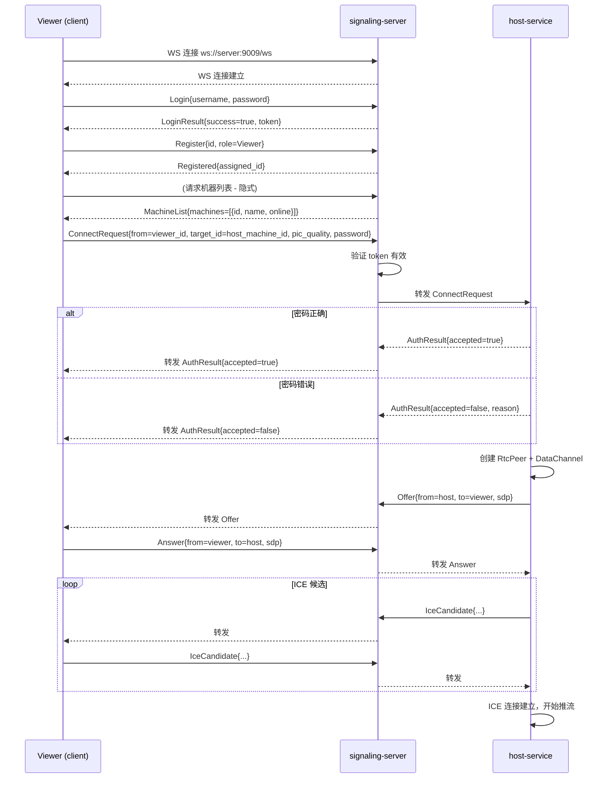
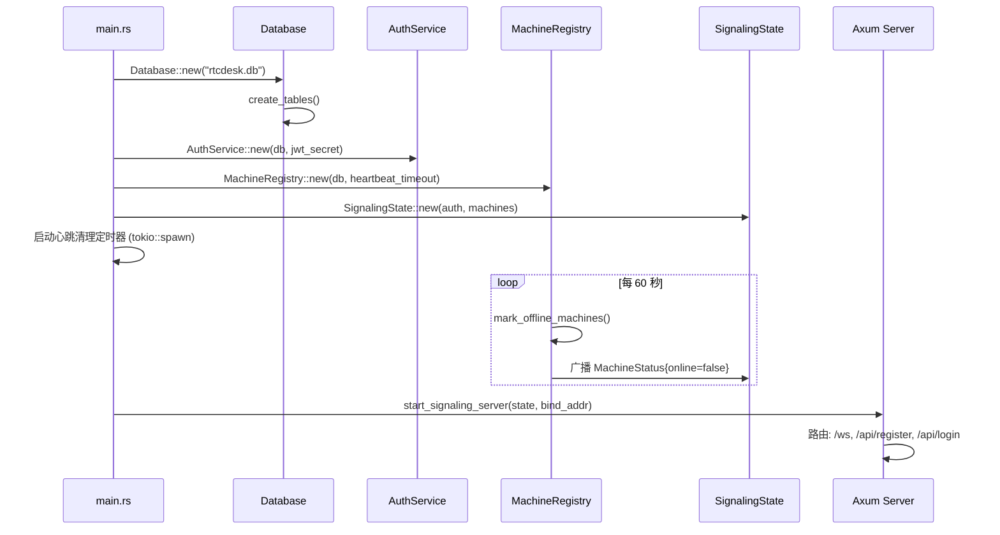
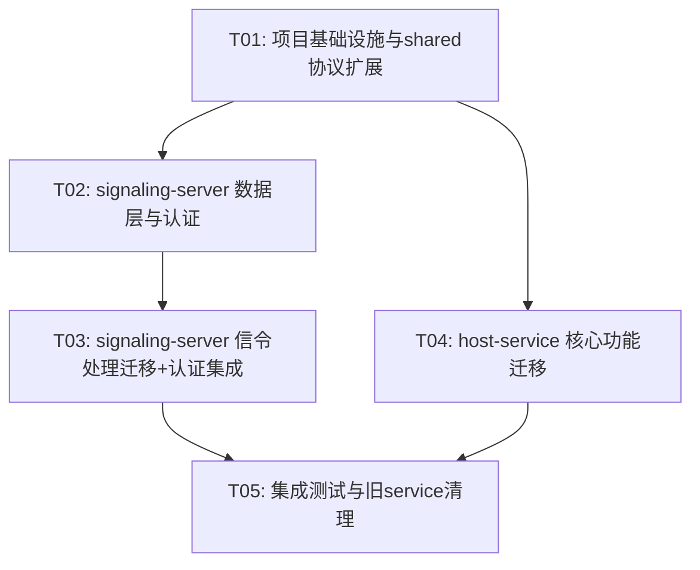

# 系统架构设计：service 单体拆分为 signaling-server + host-service

## Part A：系统设计

---

### 1. 实现方案与框架选型

#### 1.1 核心技术挑战

| 挑战 | 分析 | 方案 |
|------|------|------|
| **服务边界划分** | 当前 `service` 同时包含信令服务器和 Host 逻辑，职责混合 | 按网络角色拆分：signaling-server 处理中心化信令+认证；host-service 处理本地硬件 |
| **认证体系引入** | 当前仅密码认证，无用户概念 | 新增 JWT + SQLite 用户存储；信令消息需携带 token |
| **协议兼容性** | client 端需要适配新协议 | shared/signal.rs 扩展新消息类型，旧消息保持向后兼容；提供 feature flag |
| **机器身份持久化** | 当前 host_id 每次随机生成 | 首次启动生成 UUID 并写入本地配置文件，后续启动复用 |
| **心跳与在线状态** | 当前仅靠 WS 连接状态判断 | signaling-server 定期检查心跳；host-service 定时发送心跳消息 |

#### 1.2 架构模式

- **signaling-server**：经典 Axum 服务器架构（Router + State + Handler），新增认证中间件层
- **host-service**：事件驱动架构（WS 消息循环 + WebRTC 事件回调 + 定时心跳）
- **通信**：两者通过 WebSocket 信令协议交互，host-service 是 WS 客户端，signaling-server 是 WS 服务端

#### 1.3 框架与库选型

| 库 | 用途 | 选型理由 |
|----|------|----------|
| axum 0.8 (已有) | signaling-server HTTP/WS 框架 | 已在用，成熟稳定 |
| rusqlite 0.31 | signaling-server 用户存储 | P0 本地 SQLite，轻量无外部依赖 |
| jsonwebtoken 9 | JWT 签发与验证 | Rust 生态主流 JWT 库 |
| argon2 0.5 | 密码哈希 | OWASP 推荐的密码哈希算法 |
| chrono 0.4 | 时间处理（JWT 过期时间等） | 已在 client 中使用，生态成熟 |
| dirs 6 | host-service 配置文件路径 | 跨平台标准路径获取 |

---

### 2. 文件列表

#### 2.1 signaling-server 目录结构

```
signaling-server/
├── Cargo.toml
└── src/
    ├── main.rs              # 入口：解析配置、初始化DB、启动axum服务
    ├── signaling.rs         # WS信令处理（从 service/signaling.rs 迁移+重构）
    ├── auth.rs              # 用户注册/登录、JWT签发/验证、认证中间件
    ├── db.rs                # SQLite数据访问层（用户表、机器表）
    └── machine.rs           # 机器注册、在线状态、心跳检查、机器列表查询
```

#### 2.2 host-service 目录结构

```
host-service/
├── Cargo.toml
└── src/
    ├── main.rs              # 入口：读取配置、登录获取token、连接信令、主循环
    ├── signal_client.rs     # 信令客户端：WS连接、登录、心跳发送、消息收发
    ├── peer.rs              # WebRTC Peer（从 service/peer.rs 迁移，无改动）
    └── capture.rs           # 屏幕捕获（从 service/capture.rs 迁移，无改动）
```

#### 2.3 shared 变更

```
shared/
├── Cargo.toml              # 新增依赖：jsonwebtoken（可选feature）
└── src/
    ├── lib.rs              # 新增 pub mod auth
    ├── signal.rs           # 扩展新消息类型
    ├── frame.rs            # 不变
    └── auth.rs             # 新增：JWT Claims、Token 相关类型
```

#### 2.4 workspace Cargo.toml 变更

```toml
[workspace]
members = ["tools", "shared", "signaling-server", "host-service", "client"]
# 移除 "service"
```

---

### 3. 数据结构与接口

#### 3.1 类图



#### 3.2 新增 SignalMessage 变体详解

```rust
// shared/src/signal.rs 新增

/// 用户登录请求
Login {
    username: String,
    password: String,
},

/// 登录结果
LoginResult {
    success: bool,
    #[serde(default)]
    token: String,        // JWT token，成功时返回
    #[serde(default)]
    reason: String,       // 失败原因
},

/// Host 注册机器信息
MachineRegister {
    machine_id: String,   // 本地生成的 UUID
    name: String,         // 机器名
    os: String,           // 操作系统
},

/// 在线机器列表（信令服务器推送或应答）
MachineList {
    machines: Vec<MachineInfo>,
},

/// 机器在线状态变更通知
MachineStatus {
    machine_id: String,
    online: bool,
},

/// 心跳消息（Host 定期发送）
Heartbeat {
    machine_id: String,
},

/// Token 刷新请求
TokenRefresh {
    token: String,
},

/// Token 刷新结果
TokenRefreshResult {
    success: bool,
    #[serde(default)]
    token: String,
    #[serde(default)]
    reason: String,
},
```

#### 3.3 新增 shared/src/auth.rs

```rust
/// JWT Claims 结构
#[derive(Debug, Clone, Serialize, Deserialize)]
pub struct Claims {
    pub sub: String,       // user_id
    pub username: String,
    pub role: PeerRole,
    pub exp: i64,          // 过期时间（Unix timestamp）
    pub iat: i64,          // 签发时间
}

pub const JWT_EXPIRE_SECS: i64 = 86400;     // 24小时
pub const JWT_REFRESH_BEFORE_SECS: i64 = 3600; // 过期前1小时可刷新
```

#### 3.4 数据库表结构

**users 表：**
```sql
CREATE TABLE IF NOT EXISTS users (
    id          INTEGER PRIMARY KEY AUTOINCREMENT,
    username    TEXT NOT NULL UNIQUE,
    password_hash TEXT NOT NULL,
    created_at  TEXT NOT NULL DEFAULT (datetime('now'))
);
```

**machines 表：**
```sql
CREATE TABLE IF NOT EXISTS machines (
    machine_id    TEXT PRIMARY KEY,
    user_id       INTEGER NOT NULL,
    name          TEXT NOT NULL DEFAULT '',
    os            TEXT NOT NULL DEFAULT '',
    last_heartbeat INTEGER NOT NULL DEFAULT 0,
    online        INTEGER NOT NULL DEFAULT 0,
    FOREIGN KEY (user_id) REFERENCES users(id)
);
```

---

### 4. 程序调用流程

#### 4.1 Host 启动流程（含认证）



#### 4.2 Viewer 连接流程



#### 4.3 信令服务器启动流程



---

### 5. 待明确事项

| # | 事项 | 当前假设 | 建议 |
|---|------|----------|------|
| 1 | Viewer 是否也需要登录获取 token？ | 假设是，登录后才能获取机器列表 | PM 需确认：是否所有 Viewer 都需账号，或允许匿名 Viewer |
| 2 | JWT secret 如何配置？ | 假设通过环境变量 `RTCDESK_JWT_SECRET`，首次自动生成 | 建议首次启动自动生成并持久化到文件 |
| 3 | 机器列表是仅返回自己的机器，还是返回所有在线机器？ | 假设 P0 返回所有在线机器（简单方案） | 后续可加用户隔离 |
| 4 | host-service 的本地配置文件路径？ | `~/.config/rtcdesk/host.toml` (Linux), `%APPDATA%/rtcdesk/host.toml` (Windows) | 使用 dirs crate 跨平台处理 |
| 5 | client 端何时适配新协议？ | 假设本阶段不涉及 client 改动 | 需确认：是否用 feature flag 让新旧协议共存 |
| 6 | SQLite 数据文件位置？ | 与 signaling-server 二进制同目录下 `rtcdesk.db` | 可通过环境变量覆盖 |

---

## Part B：任务分解

---

### 6. 所需依赖包

#### signaling-server 新增依赖

```
rusqlite@0.31         # SQLite 数据库
jsonwebtoken@9        # JWT 签发/验证
argon2@0.5            # 密码哈希（Argon2id）
chrono@0.4            # 时间处理（已有 workspace 依赖）
```

#### host-service 新增依赖

```
dirs@6                # 跨平台配置目录
toml@0.8              # 配置文件读写
serde@1               # 配置文件反序列化（已有）
```

#### shared 新增依赖

```
jsonwebtoken@9        # Claims 类型定义（可选，或直接在 shared 中定义 struct）
chrono@0.4            # 时间类型（已有 workspace 依赖）
```

---

### 7. 任务列表

#### T01：项目基础设施与 shared 协议扩展

**任务描述**：更新 workspace Cargo.toml（移除 service、新增 signaling-server 和 host-service）、创建两个新 crate 的 Cargo.toml、扩展 shared/signal.rs 新增信令消息类型、新增 shared/auth.rs 定义 JWT Claims 及常量。

**涉及文件**：
- `Cargo.toml` (workspace root)
- `shared/Cargo.toml`
- `shared/src/lib.rs`
- `shared/src/signal.rs`
- `shared/src/auth.rs` (新增)
- `signaling-server/Cargo.toml` (新增)
- `signaling-server/src/main.rs` (新增，骨架)
- `host-service/Cargo.toml` (新增)
- `host-service/src/main.rs` (新增，骨架)

**前置依赖**：无

**优先级**：P0

**预估复杂度**：M

---

#### T02：signaling-server 数据层与认证模块

**任务描述**：实现 SQLite 数据访问层（db.rs：用户表/机器表的 CRUD）、认证服务（auth.rs：注册/登录/密码哈希/JWT 签发/验证/token 刷新）、机器注册/心跳/在线状态管理（machine.rs）。signaling-server/main.rs 初始化 DB 和启动服务器。

**涉及文件**：
- `signaling-server/src/db.rs` (新增)
- `signaling-server/src/auth.rs` (新增)
- `signaling-server/src/machine.rs` (新增)
- `signaling-server/src/main.rs` (修改)

**前置依赖**：T01

**优先级**：P0

**预估复杂度**：L

---

#### T03：signaling-server 信令处理（迁移+认证集成）

**任务描述**：从 service/signaling.rs 迁移信令处理到 signaling-server/src/signaling.rs，集成认证：WS 连接建立时要求 Login、消息转发前验证 token、处理 MachineRegister/Heartbeat/MachineList 等新消息、注册 HTTP API 路由（/api/register, /api/login）、心跳超时清理定时器。

**涉及文件**：
- `signaling-server/src/signaling.rs` (从 service/signaling.rs 迁移+重构)
- `signaling-server/src/main.rs` (修改，添加路由和定时器)

**前置依赖**：T02

**优先级**：P0

**预估复杂度**：L

---

#### T04：host-service 核心功能迁移（信令客户端+Host逻辑）

**任务描述**：实现 signal_client.rs（WS 客户端连接、登录、心跳、消息收发），从 service/main.rs 迁移 Host 主循环逻辑到 host-service/src/main.rs（去掉内嵌信令服务器启动，改为连接远程信令服务器），添加本地配置文件读写（machine_id 持久化），登录+token 认证流程。

**涉及文件**：
- `host-service/src/signal_client.rs` (新增)
- `host-service/src/main.rs` (从 service/main.rs 迁移+重构)
- `host-service/src/peer.rs` (从 service/peer.rs 迁移)
- `host-service/src/capture.rs` (从 service/capture.rs 迁移)

**前置依赖**：T01

**优先级**：P0

**预估复杂度**：L

---

#### T05：集成测试与旧 service 清理

**任务描述**：编写 signaling-server 与 host-service 的集成测试（登录→注册→心跳→消息转发→WebRTC 建立），验证端到端流程；删除旧 service 目录；更新 client 依赖指向 shared（如有需要）；验证 workspace 编译通过。

**涉及文件**：
- `service/` (删除整个目录)
- `Cargo.toml` (workspace root，确认移除 service)
- `tests/` 或各 crate 内 `tests/` (新增集成测试)
- `client/Cargo.toml` (如有依赖调整)

**前置依赖**：T03, T04

**优先级**：P1

**预估复杂度**：M

---

### 8. 共享知识

```
- 所有 WS 信令消息使用 JSON 序列化，格式为 SignalMessage 枚举（serde tag = "type"）
- 认证 token 通过 Login/LoginResult 流程获取，后续所有消息需在 WS 上下文中验证
- JWT token 有效期 24 小时，过期前 1 小时可刷新
- 密码哈希使用 Argon2id 算法
- 机器 ID 使用 UUID v4，首次生成后持久化到本地配置文件
- 心跳间隔：host-service 每 30 秒发送；signaling-server 超时阈值 90 秒
- 所有错误通过 SignalMessage::Error 返回，不使用 HTTP 错误码（WS 通道内）
- 环境变量命名约定：RTCDESK_ 前缀（如 RTCDESK_ADDR, RTCDESK_JWT_SECRET）
- 日志使用 log crate + env_logger，级别 info 为默认
- 数据库文件默认路径：./rtcdesk.db（可通过 RTCDESK_DB_PATH 覆盖）
- 配置文件路径使用 dirs::config_dir() / "rtcdesk" / "host.toml"
- 新旧协议兼容：feature flag "legacy-auth" 切换密码认证/JWT 认证
```

---

### 9. 任务依赖图



**说明**：T02 和 T04 可以并行开发（仅依赖 T01），T03 依赖 T02 的认证模块，T05 需要两个服务都完成后再进行。
